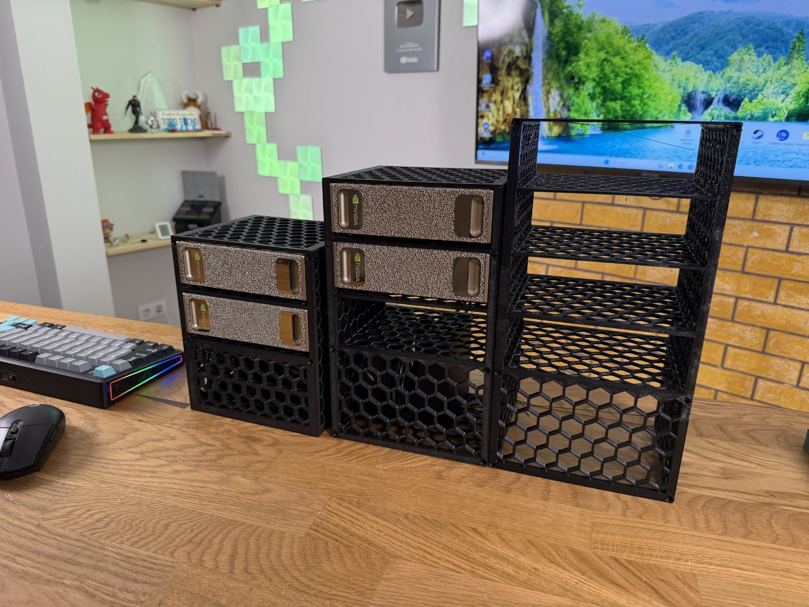
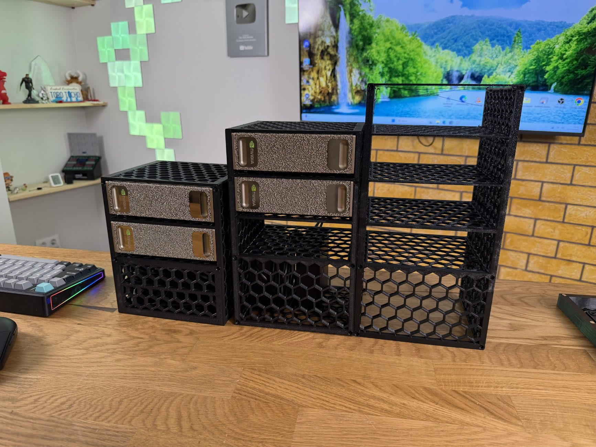
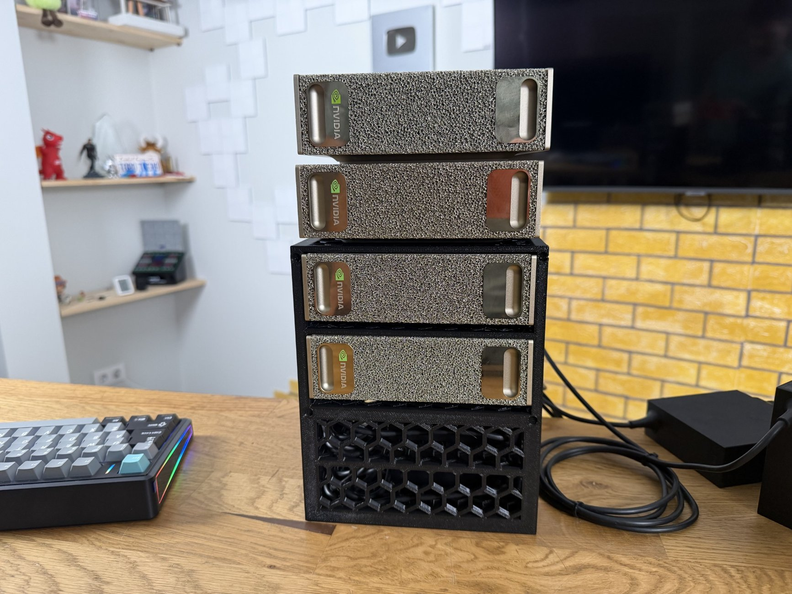
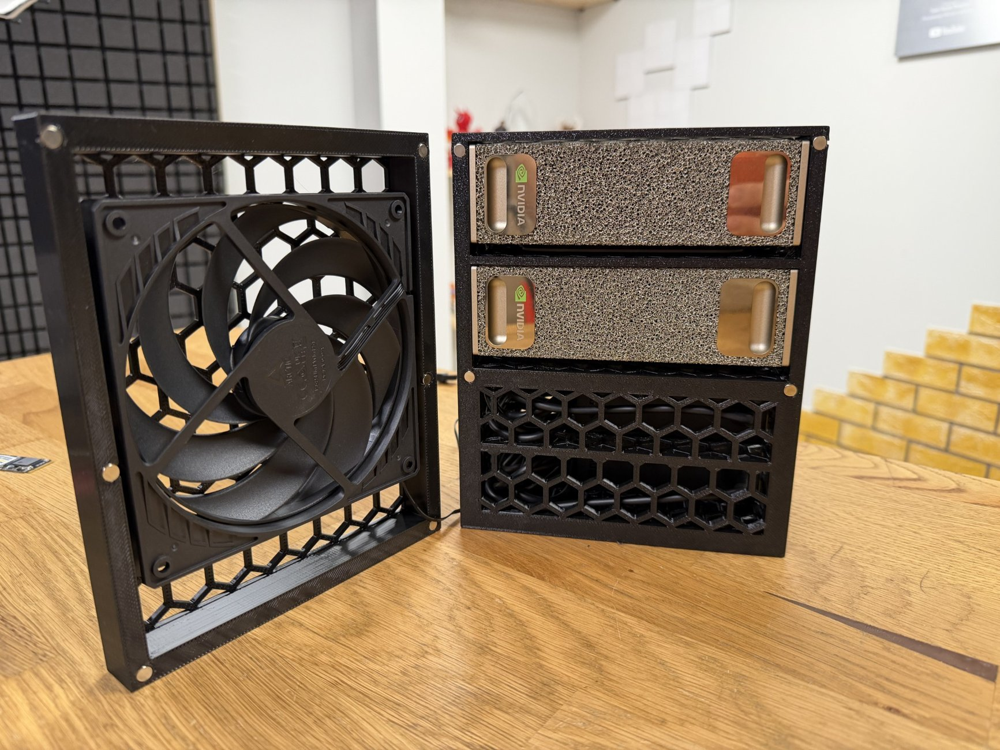
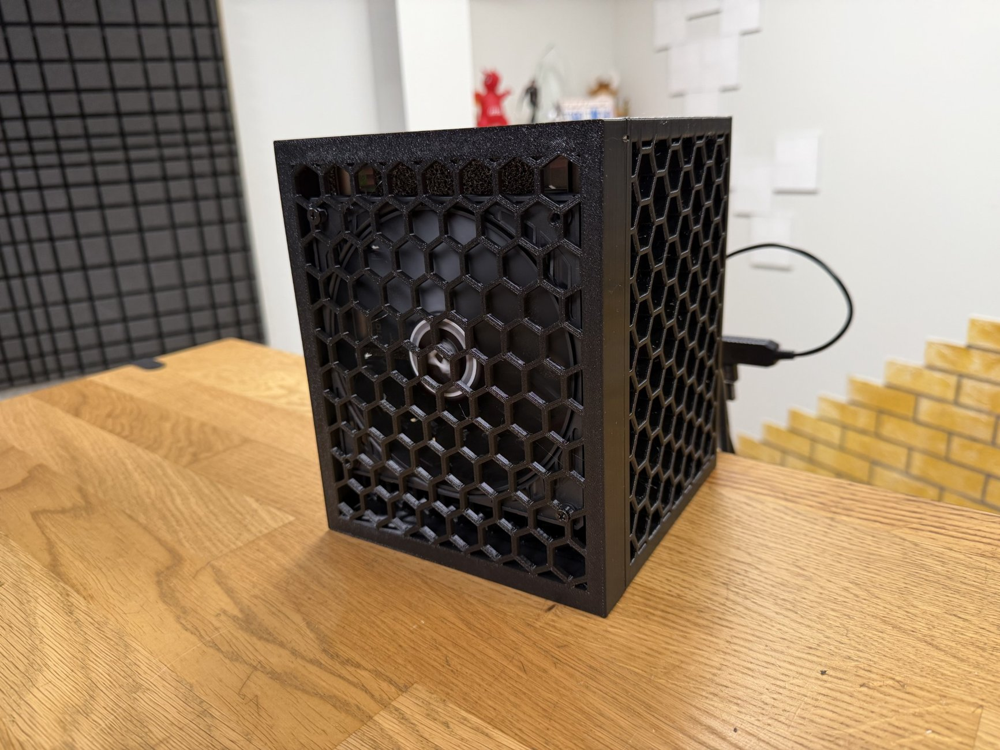
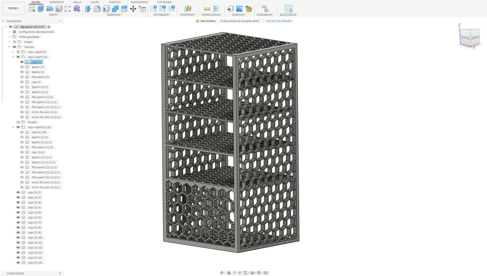
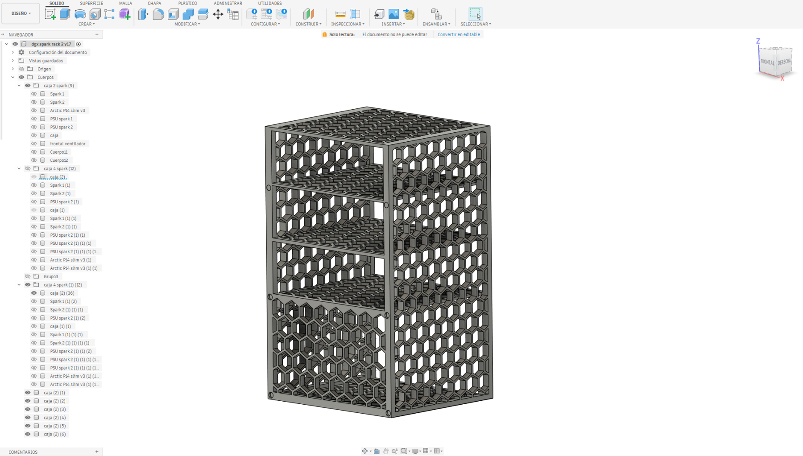

# NVIDIA DGX Spark — 3D-Printed Modular Rack

### One compact home for 2, 3 or 4 NVIDIA DGX Spark systems

**Free STL models · PETG 3D printing · Real-world thermal testing**

*Designed and tested by Toro Tocho Reviews.*

[**Download 2-Spark STL**](STL/DGX-Spark-Rack-2-Units.stl) · [**Download 3-Spark STL**](STL/DGX-Spark-Rack-3-Units.stl) · [**Download 4-Spark STL**](STL/DGX-Spark-Rack-4-Units.stl)

---

## 📸 The finished build

A modular, open-ventilated rack for stacking multiple NVIDIA DGX Spark computers without taking over the desk. The honeycomb side panels help maintain airflow while keeping the design lightweight and printable.

| Front view | Two-Spark setup |
|:---:|:---:|
|  |  |

### Close-up details

| Optional fan experiment | Honeycomb ventilation |
|:---:|:---:|
|  |  |

---

## ⬇️ Download the 3D-printable models

All three configurations are included in the [**STL folder**](STL/). Click the desired model below to open or download it.

| Rack | STL download | Approximate dimensions (X × Y × Z) |
|:---|:---|:---|
| **2 × DGX Spark** | [DGX-Spark-Rack-2-Units.stl](STL/DGX-Spark-Rack-2-Units.stl) | 166 × 144 × 203 mm |
| **3 × DGX Spark** | [DGX-Spark-Rack-3-Units.stl](STL/DGX-Spark-Rack-3-Units.stl) | 166.4 × 144.4 × 270.9 mm |
| **4 × DGX Spark** | [DGX-Spark-Rack-4-Units.stl](STL/DGX-Spark-Rack-4-Units.stl) | 166.4 × 144.4 × 324.4 mm |

*Dimensions are approximate and assume millimeter units. Verify them in your slicer before printing.*

## 🛠️ CAD design gallery

Designed in **Fusion 360**, with configurations for two, three and four computers.

| Two-Spark design | Four-Spark design |
|:---:|:---:|
|  |  |

| Three-Spark design | Two-Spark fan experiment |
|:---:|:---:|
|  |  |

---

## 🖨️ Printing recommendations

> [!IMPORTANT]
> **Use PETG rather than PLA.** DGX Spark computers produce sustained heat under heavy AI workloads; PLA can soften or deform. Check fit, ventilation and temperature before leaving the rack running unattended.

- **Material:** PETG recommended.
- **PETG filament used for my prints:** [View the exact filament on Amazon](https://link.amazon/B0gaBhhx7).
- **Build volume:** check each STL in your slicer; the larger racks need a tall print area.
- **Orientation and supports:** choose these based on your printer and inspect the sliced toolpaths.
- **Airflow:** keep all device intake and exhaust openings clear.
- **Stability:** place the rack on a firm, level surface.

### Why are the computers so close together?

My printer was already at its build-volume limit, so the tight spacing is a compromise to make the rack printable on my machine. **If you have a larger printer, consider increasing the distance between devices** for more breathing room and potentially better cooling. A wider rack will naturally be less compact.

## 🌡️ Cooling tests: do you need an extra fan?

I also tested a version with an additional fan. In my setup, it reduced temperatures by only **around 3–4 °C**. Given that modest improvement, I generally **prefer the simpler fanless design**. Thermal results depend on workload, ambient temperature and airflow, so monitor your own system.

## 💰 PETG vs. aluminum

An aluminum enclosure could theoretically offer better heat spreading **if it were specifically engineered to make effective thermal contact with the devices**. Simply swapping PETG for aluminum would not guarantee better cooling.

Custom aluminum fabrication could cost hundreds of dollars. My PETG prints cost **approximately US$15 per piece**, making the printed approach far more accessible.

## 🔌 The power-adapter problem

Using two to four DGX Spark computers means dealing with multiple large power bricks and cables. An **official, appropriately engineered NVIDIA multi-output power solution** would make multi-unit setups cleaner. Until then, use the approved individual power supplies and do not improvise power wiring.

## ⚠️ Safety and disclaimer

This is an **independent maker project**, not an official NVIDIA product or certified enclosure. Verify mechanical fit and stability, do not obstruct ventilation, and monitor temperatures and possible PETG deformation during extended operation. Use at your own risk.

## ❤️ About the creator

Created by **[Toro Tocho Reviews](https://www.youtube.com/@TorotochoReviews)**, a YouTube channel focused on PC hardware, local AI, 3D printing and hands-on maker projects.

- **YouTube:** [Toro Tocho Reviews](https://www.youtube.com/@TorotochoReviews)
- **Instagram:** [@toro_tocho](https://www.instagram.com/toro_tocho/)
- **TikTok:** [@toro_tocho](https://www.tiktok.com/@toro_tocho)

If you print one, share your build!

## 📄 License

Released under **Creative Commons Attribution 4.0 International (CC BY 4.0)**. Read the full [LICENSE](LICENSE). Attribution is required; the license also permits commercial reuse under its terms.
